# Class Activity 1 — System Calls in Practice

- **Student Name:** HUONG PHYNANN
- **Student ID:** e20230363
- **Date:** 2026-10-20

---

## Warm-Up: Hello System Call

Screenshot of running `hello_syscall.c` on Linux:

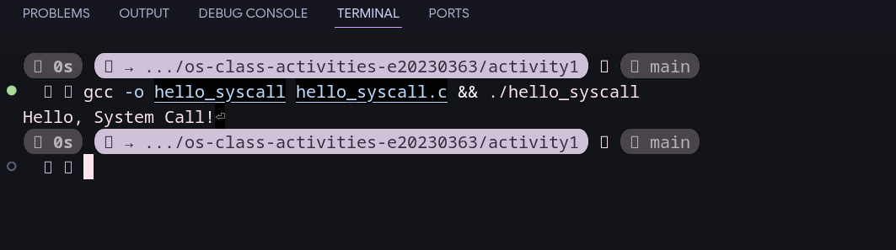

Screenshot of running `copyfilesyscall.c` on Linux:

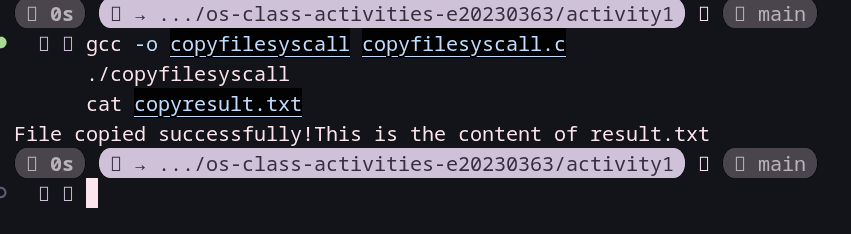

---

## Task 1: File Creator & Reader

### Part A — File Creator

**Describe your implementation:** Both versions create or truncate `output.txt`, write the same text, and close the file. Version A uses `fopen()`, `fprintf()`, and `fclose()`; Version B uses `open()`, `write()`, and `close()`.

**Version A — Library Functions (`file_creator_lib.c`):**

<!-- Screenshot: gcc -o file_creator_lib file_creator_lib.c && ./file_creator_lib && cat output.txt -->
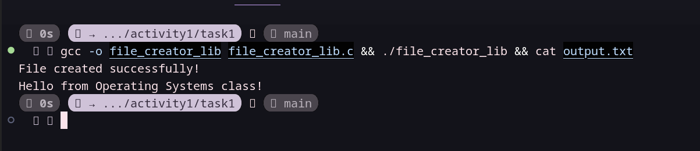

**Version B — POSIX System Calls (`file_creator_sys.c`):**

<!-- Screenshot: gcc -o file_creator_sys file_creator_sys.c && ./file_creator_sys && cat output.txt -->
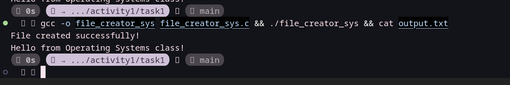

**Questions:**

1. **What flags did you pass to `open()`? What does each flag mean?**

   > I used O_WRONLY | O_CREAT | O_TRUNC.
   >
   > - O_WRONLY: Opens the file for writing only.
   > - O_CREAT: Creates the file if it does not exist.
   > - O_TRUNC: Clears the existing contents if the file already exists.

2. **What is `0644` in the permission argument? What does each digit represent?**

   > 0644 is an octal number that specifies the requested file permissions.
   >
   > - 6 (owner): Read (4) + write (2).
   > - 4 (group): Read only.
   > - 4 (others): Read only.

3. **What does `fopen("output.txt", "w")` do internally that you had to do manually with `open()`?**

   > `fopen()` opens or creates the file for writing and truncates existing contents. It also creates a buffered `FILE` stream. With `open()`, I had to specify the flags and permissions manually, then use `write()` and `close()` with the returned file descriptor.

### Part B — File Reader & Display

**Describe your implementation:** Version A reads text with `fopen()` and `fgets()` and displays it with `printf()`. Version B opens the file, reads byte chunks in a loop, writes each chunk to standard output, and closes the file.

**Version A — Library Functions (`file_reader_lib.c`):**

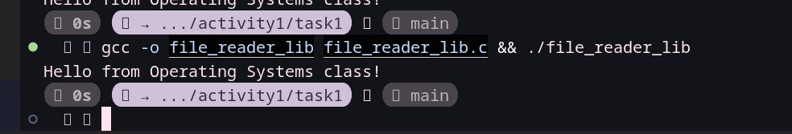

**Version B — POSIX System Calls (`file_reader_sys.c`):**

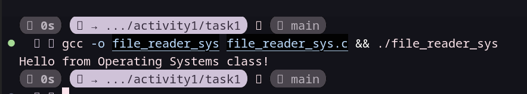

**Questions:**

1. **What does `read()` return? How is this different from `fgets()`?**

   > `read()` returns the number of bytes successfully read, `0` when it reaches the end of the file, or `-1` if an error occurs. `fgets()` reads text into a string until it encounters a newline, reaches the buffer limit, or reaches EOF. When successful, `fgets()` adds a null terminator.

2. **Why do you need a loop when using `read()`? When does it stop?**

   > A loop is needed because `read()` may return fewer bytes than the buffer can hold, so more reading may be necessary. The loop stops when `read()` returns `0`, which indicates the end of the file. If it returns `-1`, a reading error has occurred.

---

## Task 2: Directory Listing & File Info

**Describe your implementation:** Version A formats the listing with `printf()`. Version B uses `opendir()`, `readdir()`, and `stat()` to get entries and sizes, formats each line with `snprintf()`, and writes it with `write()`.

### Version A — Library Functions (`dir_list_lib.c`)

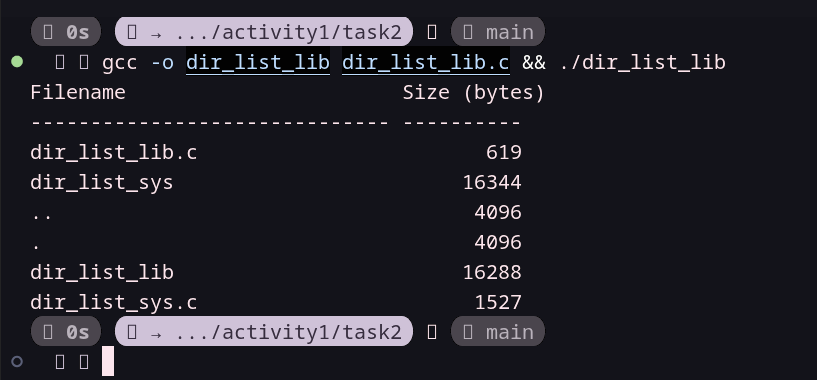

### Version B — System Calls (`dir_list_sys.c`)

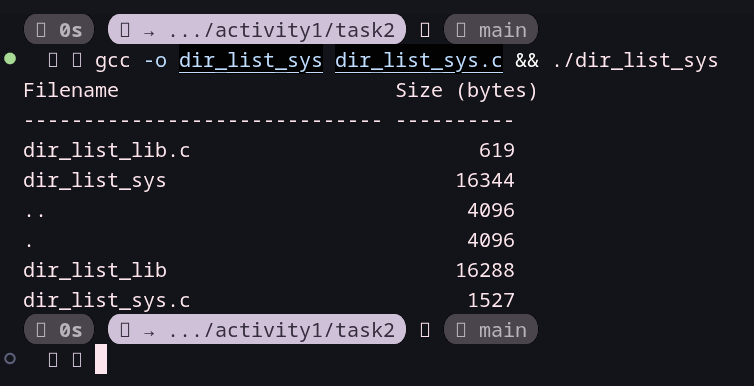

### Questions

1. **What struct does `readdir()` return? What fields does it contain?**

   > `readdir()` returns a pointer to a `struct dirent`, which represents a directory entry. Important fields include `d_name`, the entry's filename, and `d_ino`, its inode number. It may also contain `d_type`, which indicates the entry type on supported filesystems.

2. **What information does `stat()` provide beyond file size?**

   > `stat()` provides metadata such as file type, permissions, inode number, owner ID, group ID, number of hard links, and access, modification, and status-change timestamps.

3. **Why can't you just `write(1, some_number, ...)` directly — why do you need `snprintf()` first?**

   > `write()` expects a pointer to bytes, not an integer value. `snprintf()` converts the filename and file size into formatted text in a buffer. Then `write()` can display that text on the terminal.

---

## Task 3: strace Analysis

**Describe what you observed:** The Task 1 library versions made five more total system calls than their system-call counterparts in these runs. The Task 2 system-call version made seven more than its library version and issued nine `write()` calls instead of one.

### strace Output — Library Version (File Creator)

<!-- Screenshot: strace -e trace=openat,read,write,close ./file_creator_lib -->
<!-- IMPORTANT: Highlight/annotate the key system calls in your screenshot -->
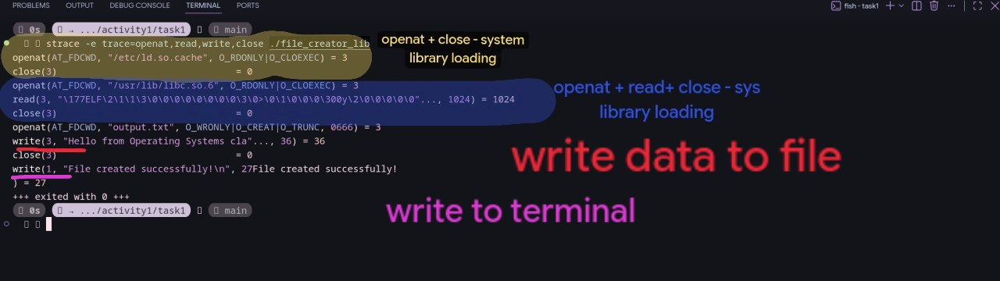

### strace Output — System Call Version (File Creator)

<!-- Screenshot: strace -e trace=openat,read,write,close ./file_creator_sys -->
<!-- IMPORTANT: Highlight/annotate the key system calls in your screenshot -->
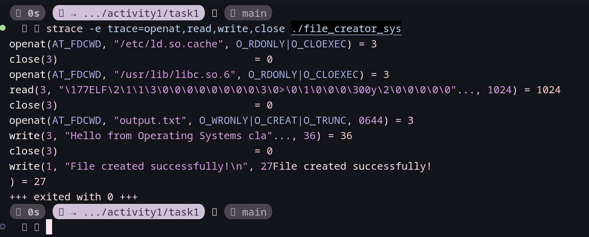

1.openat(AT_FDCWD, "output.txt", O_WRONLY|O_CREAT|O_TRUNC, 0644) = 3
   Opens/creates the file. O_WRONLY = write only, O_CREAT = create if missing, O_TRUNC = empty it if it exists, 0644 = permissions (owner rw, others read). Returns file descriptor 3.
---
2.write(3, "Hello from Operating Systems cla"..., 36) = 36
   Writes 36 bytes to fd 3 (the file). Return value 36 means all bytes were written. strace truncates the printed string, but the byte count is the full length.
---
3.close(3) = 0
   Closes the file descriptor; 0 means success. This flushes and releases the file.
---
4.write(1, "File created successfully!\n", 27) = 27
   Writes to fd 1 (stdout), the terminal. This is the printf/puts message. Its text appears interleaved in the output because stdout is your terminal.
---
### strace Output — Library Version (File Reader or Dir Listing)

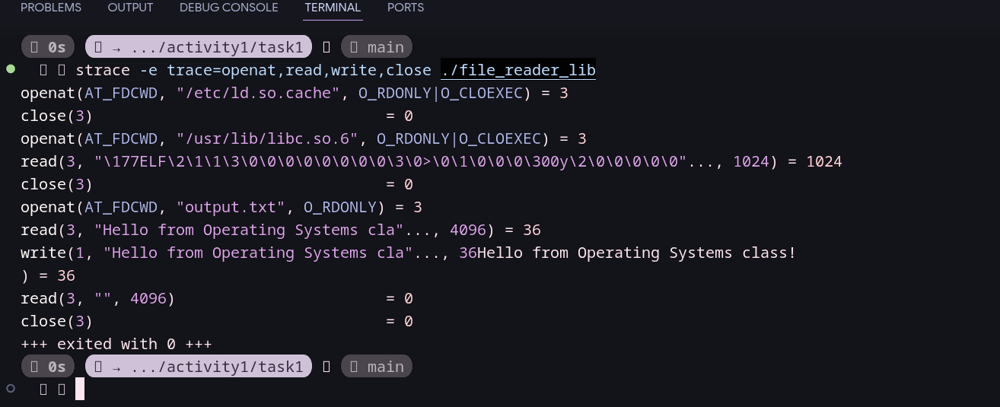

### strace Output — System Call Version (File Reader or Dir Listing)

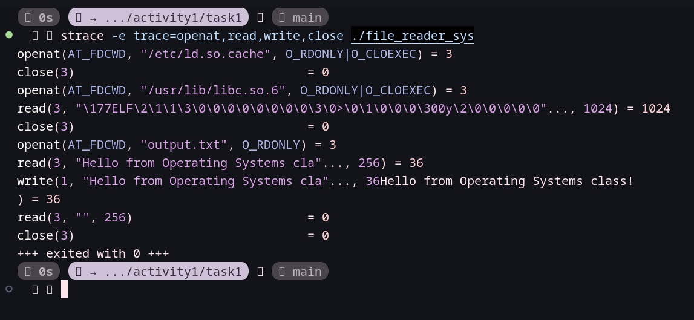

### strace -c Summary Comparison

<!-- Screenshot of `strace -c` output for both versions -->
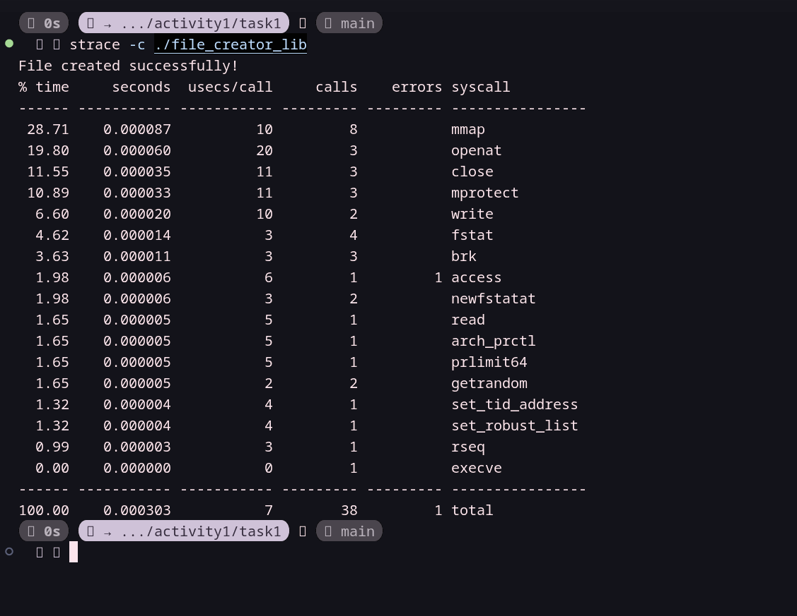
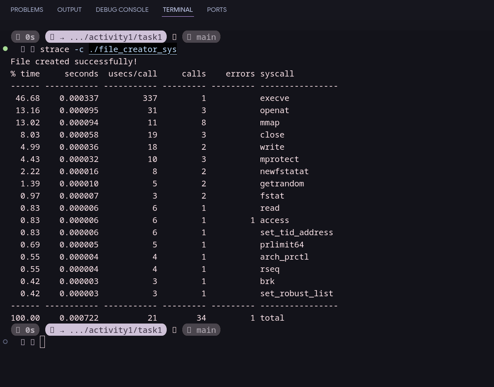

### Questions

1. **How many system calls does the library version of Task 1 make compared to the system call version? (Use `strace -c` output)**

   > The creator totals were 39 calls for the library version and 34 for the system-call version. The reader totals were 40 and 35. The Task 2 directory-listing totals were 47 for the library version and 54 for the system-call version. The creator made two `write()` calls in each version, the reader made one in each, and the directory-listing programs made one and nine, respectively. The measured summaries are in `task3_strace/strace_summary_*.txt`.

2. **What extra system calls do you see in the library version that are not in the system call version? What do they do? (e.g., `brk`, `mmap`, `access`, `fstat`)**

   > For both Task 1 programs, the library run had one `ioctl()` call, two more `fstat()` calls, and two more `brk()` calls than the system-call run. The trace shows `ioctl(1, TCGETS2, ...)` failed with `ENOTTY` while trying to query terminal settings; `fstat()` retrieved descriptor metadata, and `brk()` adjusted the process heap. Both versions also used common startup calls such as `mmap()`. For Task 2, the library summary had one more `fstat()` and an `ioctl()` absent from Version B, while Version B had one more `brk()` and eight more `write()` calls.

3. **When the library version calls `fprintf()`, how many actual `write()` system calls does `strace` show? Does it match what you expected? Why or why not?**

   > `fprintf()` produced one `write()` to the file, as expected for this short output; it was buffered and flushed when the stream was closed. The separate `printf()` confirmation produced another `write()` to standard output.

4. **Based on the `strace` output, explain in your own words: What is the real difference between a library function and a system call?**

   > A library function runs in user space and may format or buffer data before making system calls. A system call requests a service from the kernel; `strace` shows those kernel-interface calls, not every library function.

---

## Task 4: Exploring OS Structure

### System Information

> 📸 Screenshot of `uname -a`, `/proc/cpuinfo`, `/proc/meminfo`, `/proc/version`, `/proc/uptime`:

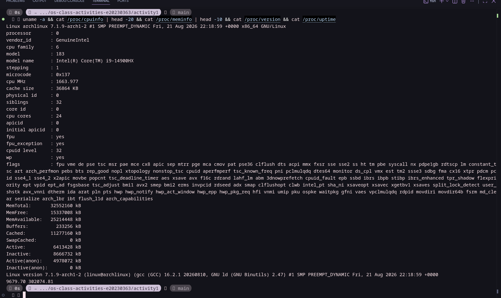

### Process Information

> 📸 Screenshot of `/proc/self/status`, `/proc/self/maps`, `ps aux`:

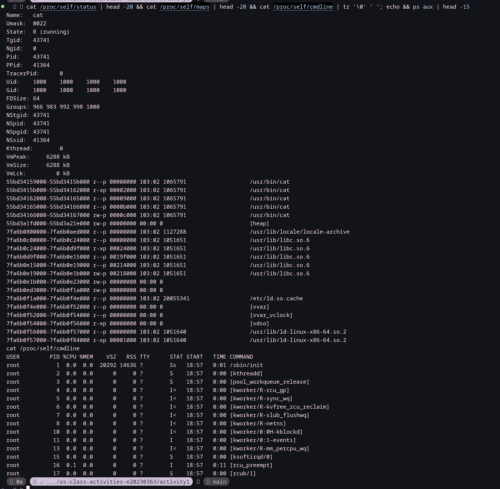

### Kernel Modules

> 📸 Screenshot of `lsmod` and `modinfo`:

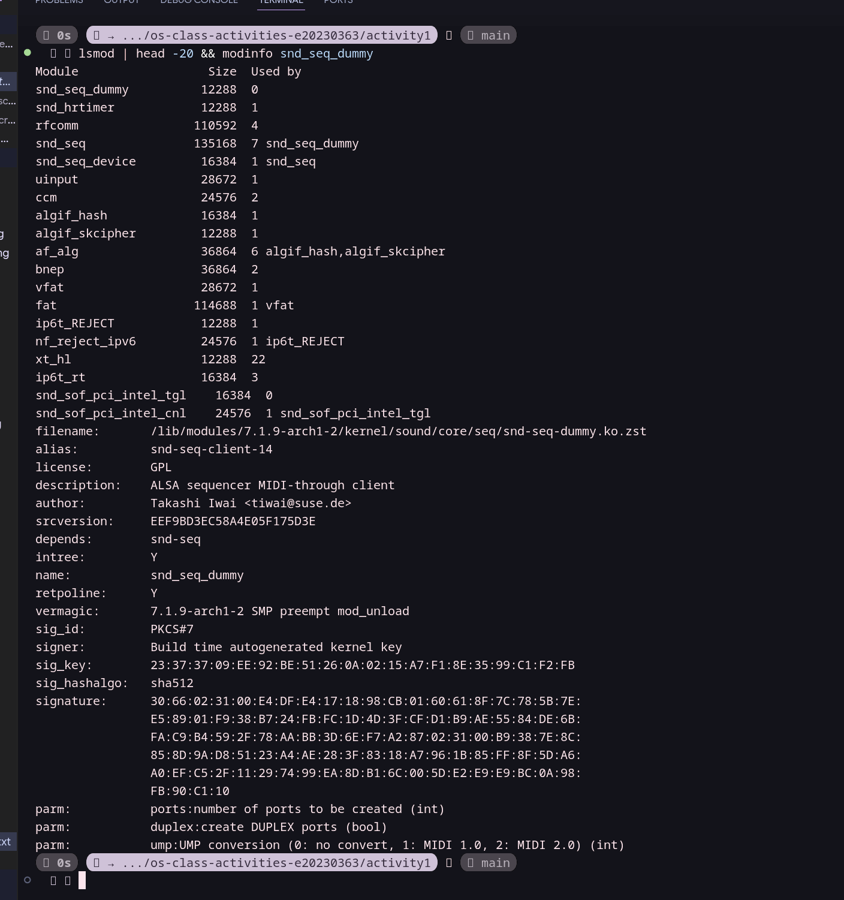

### OS Layers Diagram

> 📸 Your diagram of the OS layers, labeled with real data from your system:

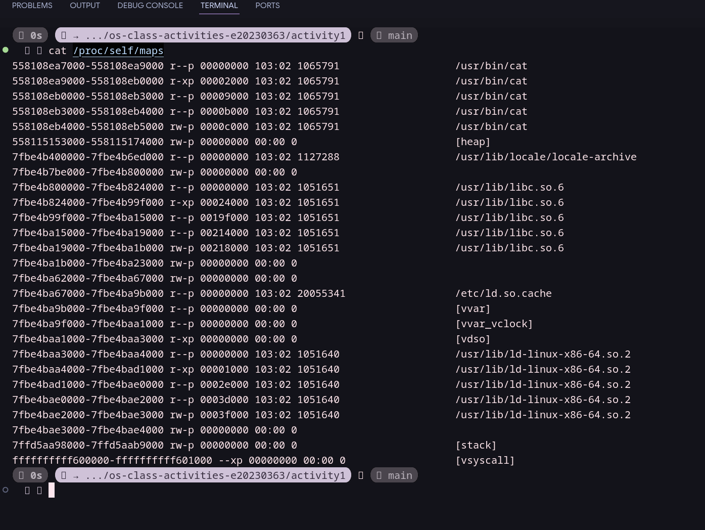

### Questions

1. **What is `/proc`? Is it a real filesystem on disk? Where does its content come from?**

   > `/proc` is a virtual filesystem, not stored on disk. The kernel generates its entries from current system and process information.

2. **What is the difference between a monolithic kernel and a microkernel? Based on the `lsmod` output, which type does Linux use?**

   > A monolithic kernel runs most operating-system services in kernel space; a microkernel keeps a smaller core in kernel space and moves more services to user space. Linux uses a monolithic kernel with loadable modules, including `snd_seq_dummy`, `snd_hrtimer`, and `rfcomm`.

3. **Look at the output of `cat /proc/self/maps`. What different memory regions do you see? (e.g., heap, stack, shared libraries)**

   > The mappings show the `head` executable, heap, shared libraries such as `libc`, the dynamic loader, and kernel-provided `vvar` and `vdso` regions. The complete map also includes the stack.

4. **What does the kernel version string (from `uname -a`) tell you? Break down each part.**

   > `Linux` is the kernel name; `archlinux` is the host name; `7.1.9-arch1-2` is the kernel release; `#1` is the build number; `SMP PREEMPT_DYNAMIC` describes the build; the following date and time are the build timestamp; `x86_64` is the machine architecture; and `GNU/Linux` identifies the operating-system environment.

5. **How does `/proc` demonstrate that the OS acts as an intermediary between user programs and hardware?**

   > Programs read kernel-generated `/proc` entries to see CPU, memory, and process information. The kernel mediates access to hardware and exposes selected state through this interface rather than letting programs access hardware directly.

---

## Reflection

What did you learn from this activity? What was the most surprising difference between library functions and system calls?

> I learned that my program never touches the disk directly. It asks the kernel through system calls. With strace I saw openat create output.txt and return file descriptor 3, write send 36 bytes to it, and close release it. I also saw the dynamic linker load libc.so.6 before main even started.
