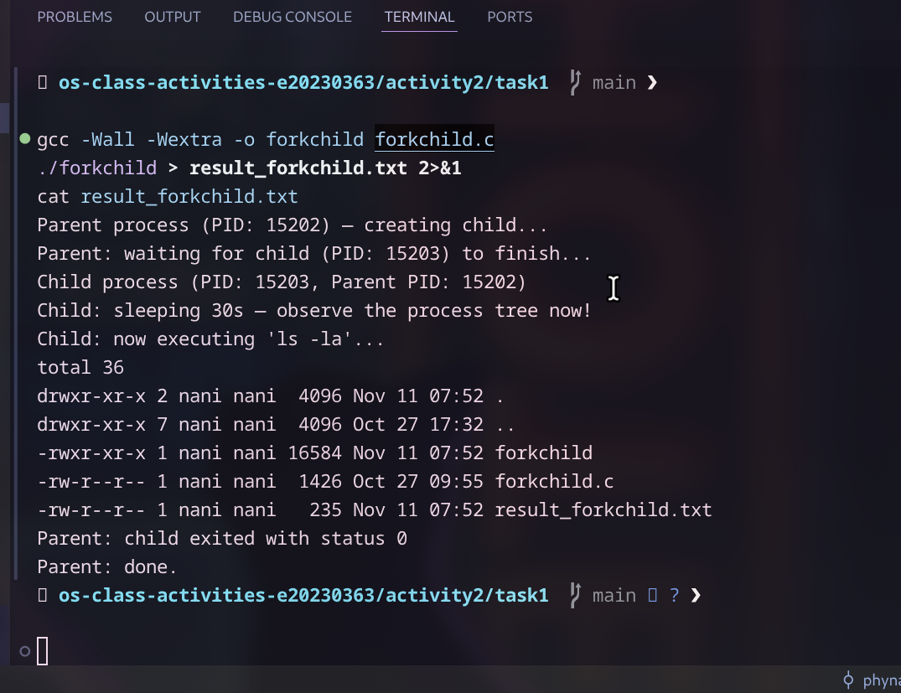
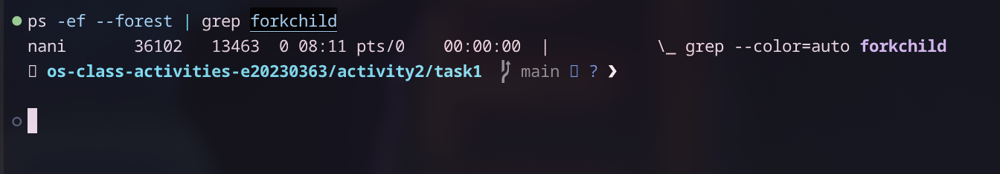
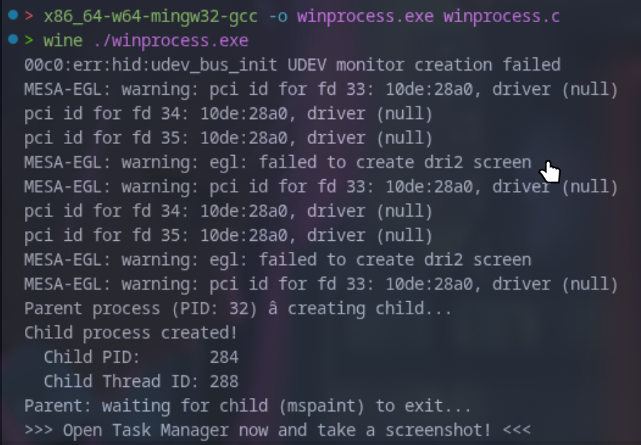
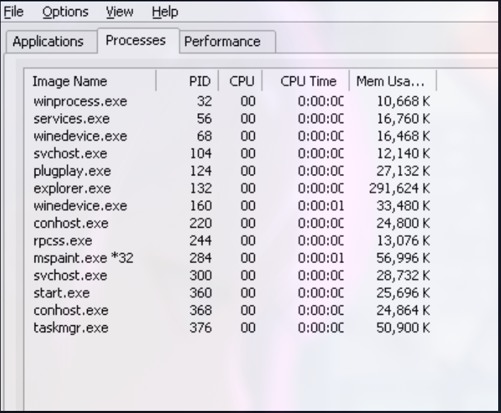
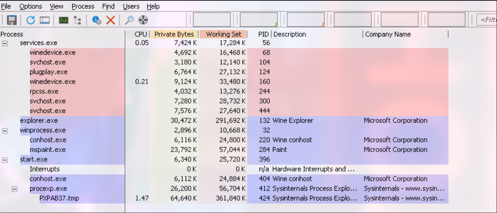
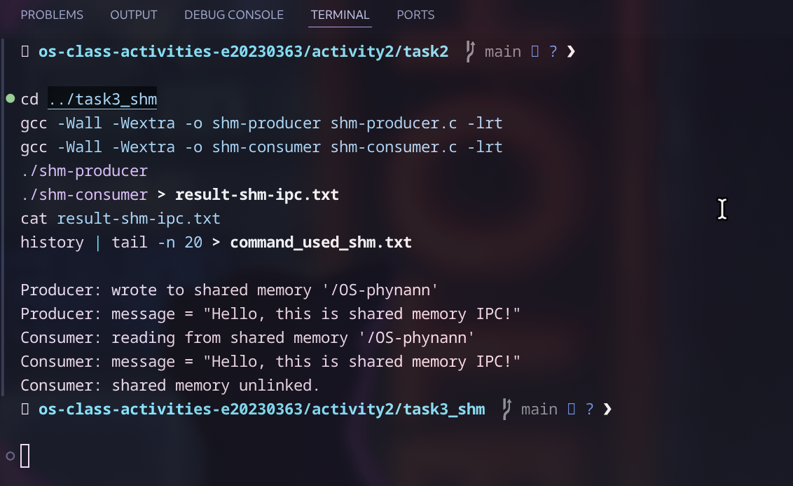
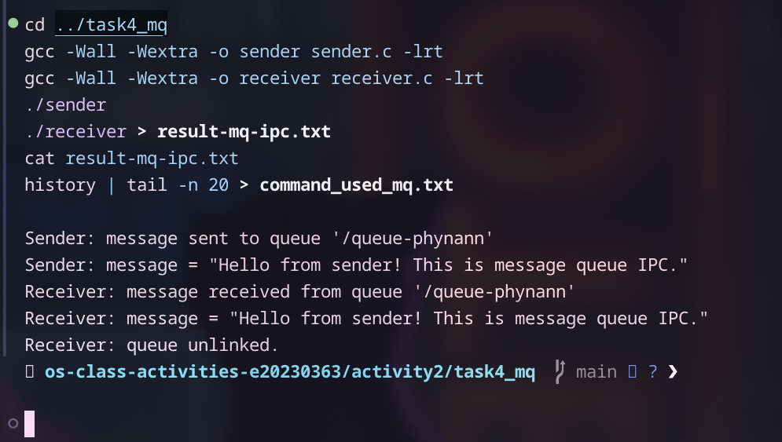

# Class Activity 2 — Processes & Inter-Process Communication

- **Student Name:** Huong Phynann
- **Student ID:** e20230363
- **Date:** 2026-10-27

> Replace the student ID if your official ID differs. Run each task on your own machine and replace all PID placeholders and sample output with your real results. Add your own screenshots to `screenshots/`; screenshots are not fabricated in this starter package.

## Task 1: Process Creation on Linux (`fork` + `exec`)

### Compilation & Execution

From the `activity2` directory:

```bash
cd task1
gcc -Wall -Wextra -o forkchild forkchild.c
./forkchild > result_forkchild.txt 2>&1
cat result_forkchild.txt
```

For the process tree, start `./forkchild` in one terminal. During the 30-second sleep, run this in a second terminal:

```bash
ps -ef --forest | grep -E 'forkchild|PID'
```

Save command history if your shell supports it:

```bash
history | tail -n 20 > command_used_forkchild.txt
```

Screenshots to add:
- 
- 

### Questions

1. **What does `fork()` return to the parent? What does it return to the child?**

   In the parent, `fork()` returns the child's PID. In the child, it returns `0`. If it fails, it returns `-1` to the parent.

2. **What happens if you remove the `waitpid()` call? Why might the output look different?**

   The parent does not wait for the child. The parent may print its final message and exit before the child finishes, so output ordering can change. The child may briefly become an orphan if its parent exits first. Waiting also lets the parent collect the child's exit status and prevents a terminated child from remaining a zombie while it is not reaped.

3. **What does `execlp()` do? Why don't we see "execlp failed" when it succeeds?**

   `execlp()` searches the `PATH` for the requested program and replaces the current process image with that program. On success it never returns, so the error-handling code after the call is reached only if execution fails.

4. **Draw the process tree for your program (parent → child). Include PIDs from your output.**

   Replace the placeholders with the PIDs printed by your run:

   ```text
   forkchild (parent PID: <PARENT_PID>)
   └── forkchild / ls (child PID: <CHILD_PID>)
   ```

   After `execlp()` succeeds, the child keeps the same PID but runs `ls`.

5. **Which command did you use to view the process tree? What information does each column show?**

   I used `ps -ef --forest`. The `UID` column shows the user, `PID` is the process ID, `PPID` is the parent process ID, `C` is a CPU-use indicator, `STIME` is the start time, `TTY` is the terminal, `TIME` is accumulated CPU time, and `CMD` is the command. The forest formatting visually indents child processes. Exact columns can vary by system.

## Task 2: Process Creation on Windows

### Compilation & Execution

Run this task on Windows, not Linux:

```powershell
gcc -Wall -Wextra -o winprocess.exe winprocess.c
.\winprocess.exe
```

If Paint is not located at `C:\Windows\System32\mspaint.exe`, update the path in `winprocess.c` to the actual executable path on your Windows installation.

Screenshots to add:
- 
- 
- 

### Questions

1. **What is the key difference between Linux `fork` + `exec` and Windows `CreateProcess`?**

   Linux commonly calls `fork()` to create a child that initially resembles the parent, then calls an `exec` function to replace the child's program. Windows `CreateProcess()` creates a new process and loads the specified executable in one API call.

2. **What does `WaitForSingleObject()` do? What is its Linux equivalent?**

   `WaitForSingleObject(pi.hProcess, INFINITE)` blocks until the process handle is signaled, normally because the child process has exited. A common Linux equivalent is `waitpid(child_pid, &status, 0)`.

3. **Why do we need to call `CloseHandle()` at the end? What happens if we don't?**

   `CloseHandle()` releases the process and thread handles opened for this program. If they are not closed, the program can leak handle resources until process termination.

4. **In Task Manager, what was the PID of your parent program and the PID of mspaint? Do they match your program's output?**

   Fill this in after running the Windows program: parent `winprocess.exe` PID: `<YOUR_PARENT_PID>`; Paint PID: `<YOUR_MSPAINT_PID>`. The Paint PID should match the `Child PID` printed by the program. Task Manager's Parent PID should identify the process that created Paint, subject to how the Windows version presents process relationships.

5. **Compare the Processes tab and the Details tab. Which view makes the relationship easier to understand? Why?**

   The Processes tab is usually easier for a quick visual understanding because it groups or nests related applications. The Details tab is more precise for checking numeric PID and Parent PID values, when that column is available.

## Task 3: Shared Memory IPC

### Compilation & Execution

```bash
cd ../task3_shm
gcc -Wall -Wextra -o shm-producer shm-producer.c -lrt
gcc -Wall -Wextra -o shm-consumer shm-consumer.c -lrt
./shm-producer
./shm-consumer > result-shm-ipc.txt
cat result-shm-ipc.txt
history | tail -n 20 > command_used_shm.txt
```

Screenshots to add:
- 

### Expected consumer output

```text
Consumer: reading from shared memory '/OS-phynann'
Consumer: message = "Hello, this is shared memory IPC!"
Consumer: shared memory unlinked.
```

### Questions

1. **What does `shm_open()` do? How is it different from `open()`?**

   `shm_open()` creates or opens a named POSIX shared-memory object. `open()` normally opens a filesystem path. Shared-memory objects are intended to be mapped into process address spaces for IPC.

2. **What does `mmap()` do? Why is shared memory faster than other IPC methods?**

   `mmap()` maps the shared-memory object into the process's virtual address space. Processes can access the same mapped data directly instead of sending every byte through a kernel-managed message operation, which can reduce copying and overhead. Synchronization is still needed when processes access shared data concurrently.

3. **Why must the shared-memory name match between producer and consumer?**

   Both processes must refer to the same named shared-memory object. Different names normally refer to different objects, so the consumer would not find the producer's data.

4. **What does `shm_unlink()` do? What would happen if the consumer didn't call it?**

   `shm_unlink()` removes the shared-memory name. If it is not unlinked, the object can remain available by name and consume system resources until it is removed. Existing mappings and open descriptors can continue to keep the object alive until released.

5. **If the consumer runs before the producer, what happens?**

   If the object does not already exist, `shm_open()` with `O_RDONLY` fails, typically with `ENOENT` (“No such file or directory”). Run the producer first. If an old object already exists, the consumer may open stale data instead, which is why cleanup matters.

## Task 4: Message Queue IPC

### Compilation & Execution

```bash
cd ../task4_mq
gcc -Wall -Wextra -o sender sender.c -lrt
gcc -Wall -Wextra -o receiver receiver.c -lrt
./sender
./receiver > result-mq-ipc.txt
cat result-mq-ipc.txt
history | tail -n 20 > command_used_mq.txt
```

Screenshots to add:
- 

### Expected receiver output

```text
Receiver: message received from queue '/queue-phynann'
Receiver: message = "Hello from sender! This is message queue IPC."
Receiver: queue unlinked.
```

### Questions

1. **How is a message queue different from shared memory? When would you use one over the other?**

   Shared memory lets processes read and write a common memory region and is useful for high-volume data when careful synchronization is possible. A message queue transfers discrete messages managed by the operating system and is useful when processes should exchange structured messages without directly sharing memory.

2. **Why does the queue name in `common.h` need to start with `/`?**

   POSIX message queue names use a leading slash and, on Linux, normally must not contain additional slashes.

3. **What does `mq_unlink()` do? What happens if neither the sender nor receiver calls it?**

   `mq_unlink()` removes the queue's name. If nobody unlinks it, the queue can persist after programs close it and may retain queued messages and consume system resources until removed.

4. **What happens if you run the receiver before the sender?**

   If the queue does not exist, `mq_open()` fails with `ENOENT` because the receiver opens it without `O_CREAT`. Run the sender first. If a leftover queue exists, the receiver may instead open that old queue.

5. **Can multiple senders send to the same queue? Can multiple receivers read from the same queue?**

   Yes. Multiple senders can open the same queue and send messages. Multiple receivers can also open it, but each received message is removed from the queue and is generally delivered to only one receiver, not broadcast to every receiver. Ordering and coordination should be considered.

## Reflection

This activity demonstrates how an operating system creates processes and allows separate processes to exchange information. Linux commonly uses `fork()` followed by `exec()`, while Windows provides `CreateProcess()` to create a process and load its program in one call. Shared memory is useful for fast access to common data, while message queues provide a structured way to send individual messages. I would choose the IPC mechanism based on the data volume, synchronization needs, and how tightly the processes should be coupled.


