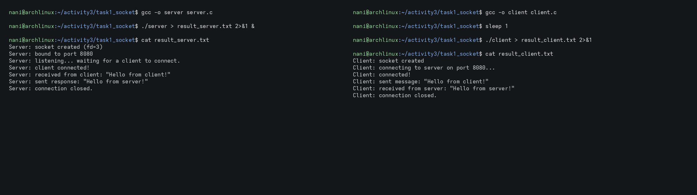
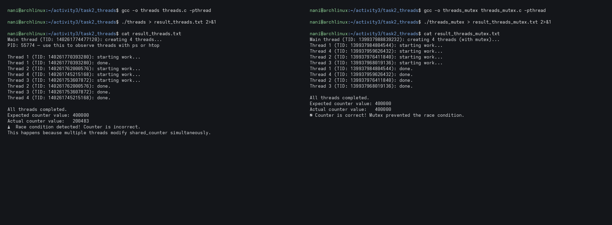
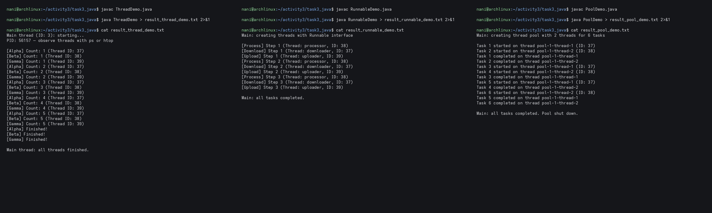
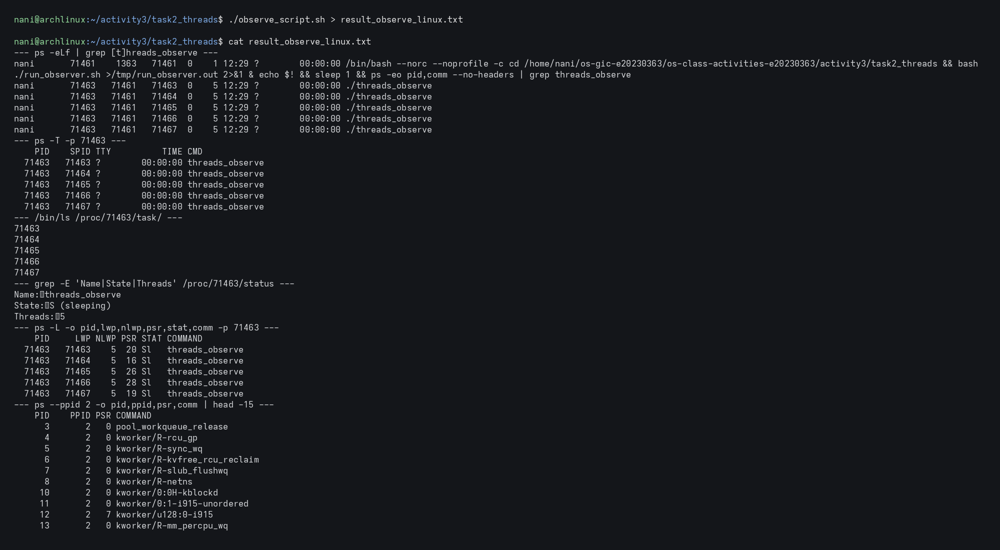
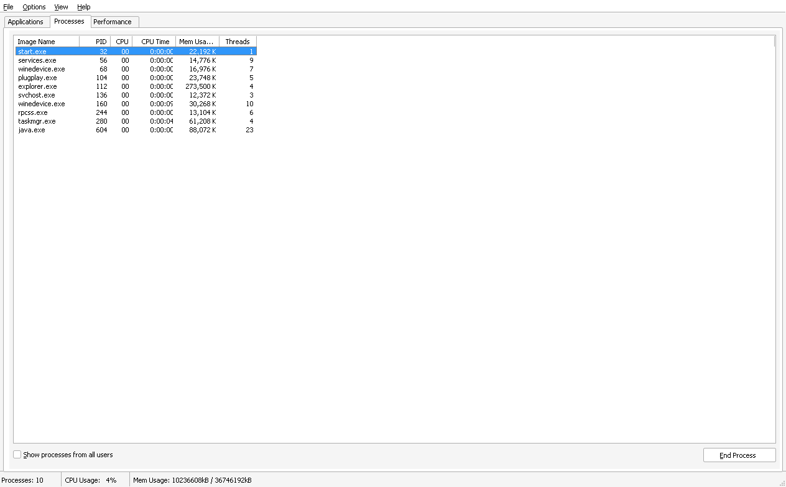

# Class Activity 3 — Socket Communication & Multithreading

- **Student Name:** HUONG PHYNANN
- **Student ID:** e20230363
- **Date:** 2026-11-17

---

## Task 1: TCP Socket Communication (C)

### Compilation & Execution



### Answers

1. **Role of `bind()` / Why client doesn't call it:**
   > `bind()` tells the OS to reserve the server port and attach the listening socket to it. The client does not call `bind()` because it does not own the port; it only connects to the server's address and port.

2. **What `accept()` returns:**
   > `accept()` returns a new connected socket file descriptor for the client. The original server socket stays open for listening, while the returned socket is the actual communication channel with that client.

3. **Starting client before server:**
   > I tried it on a temporary copy. The client printed `connect: Connection refused` and then `Client: socket created` / `Client: connecting to server on port 8080...`. That matches a real refused connection when the server was not running.

4. **What `htons()` does:**
   > `htons(PORT)` converts the port number from host byte order to network byte order. This is needed because different machines may store bytes differently, and network protocols expect a standard order.

5. **Socket call sequence diagram:**
   > Server: `socket -> bind -> listen -> accept -> read -> send -> close`  
   > Client: `socket -> connect -> send -> recv -> close`

---

## Task 2: POSIX Threads (C)

### Output — Without Mutex (Race Condition)



### Output — With Mutex (Correct)

The result is included in the same screenshot above.

### Answers

1. **What is a race condition?**
   > A race condition happens when threads change the same shared data at the same time. In `threads.c`, all 4 threads increment `shared_counter` without locking, so the final total was wrong and changed between runs.

2. **What does `pthread_mutex_lock()` do?**
   > It locks the mutex before the shared value is changed, so only one thread can update it at a time. When the lock is released, the next thread can safely enter. That stops the race.

3. **Removing `pthread_join()`:**
   > I tested the no-join version on a temporary copy. The main thread printed its message early and then exited while the worker threads were still running. The final counter was not reliable and some worker output was still arriving after main had moved on.

4. **Thread vs Process:**
   > A process is a heavier unit with its own memory space. A thread is lighter and shares the same process memory, code, heap, and file descriptors. Each thread still has its own stack and local variables.

---

## Task 3: Java Multithreading

### ThreadDemo Output



### RunnableDemo Output

Included in the same screenshot above.

### PoolDemo Output

Included in the same screenshot above.

### Answers

1. **Thread vs Runnable:**
   > Extending `Thread` makes a custom class that is the thread itself. Implementing `Runnable` is more flexible because the class can still extend another class and just provide a task. I would prefer `Runnable` for most real work because it is easier to reuse and compose.

2. **Pool size limiting concurrency:**
   > In `PoolDemo`, the pool has 2 threads, so only 2 tasks run at the same time. The other tasks wait in the queue until one of the workers is free.

3. **`thread.join()` in Java:**
   > `join()` waits for a thread to finish before the caller continues. I removed it in a temporary Java test and the main thread ended before the worker threads had finished. The output interleaved and the program ended sooner than the tasks were actually done.

4. **Why `ExecutorService` is better:**
   > It reuses worker threads, manages task queues, and avoids creating a new thread for every task. That makes large programs easier to manage and more efficient.

---

## Task 4: Observing Threads

### Linux — `ps -eLf` Output

```text
--- ps -eLf | grep '[t]hreads_observe' ---
nani       71463   71461   71463  0    5 12:29 ?        00:00:00 ./threads_observe
nani       71463   71461   71464  0    5 12:29 ?        00:00:00 ./threads_observe
nani       71463   71461   71465  0    5 12:29 ?        00:00:00 ./threads_observe
nani       71463   71461   71466  0    5 12:29 ?        00:00:00 ./threads_observe
nani       71463   71461   71467  0    5 12:29 ?        00:00:00 ./threads_observe
--- ps -T -p 71463 ---
    PID    SPID TTY          TIME CMD
  71463   71463 ?        00:00:00 threads_observe
  71463   71464 ?        00:00:00 threads_observe
  71463   71465 ?        00:00:00 threads_observe
  71463   71466 ?        00:00:00 threads_observe
  71463   71467 ?        00:00:00 threads_observe
```

### Linux — htop Thread View


### Linux — htop Kernel Threads (tree view, `kthreadd`)



### Linux — Kernel Threads (commands)


```text
--- /proc/71463/task/ listing ---
71463
71464
71465
71466
71467
--- grep -E 'Name|State|Threads' /proc/71463/status ---
Name:	threads_observe
State:	S (sleeping)
Threads:	5
--- ps -L -o pid,lwp,nlwp,psr,stat,comm -p 71463 ---
    PID     LWP NLWP PSR STAT COMMAND
  71463   71463    5  20 Sl   threads_observe
  71463   71464    5  16 Sl   threads_observe
  71463   71465    5  26 Sl   threads_observe
  71463   71466    5  28 Sl   threads_observe
  71463   71467    5  19 Sl   threads_observe
--- ps --ppid 2 -o pid,ppid,psr,comm | head -15 ---
    PID    PPID PSR COMMAND
      3       2   0 pool_workqueue_release
      4       2   0 kworker/R-rcu_gp
      5       2   0 kworker/R-sync_wq
      6       2   0 kworker/R-kvfree_rcu_reclaim
      7       2   0 kworker/R-slub_flushwq
      8       2   0 kworker/R-netns
     10       2   0 kworker/0:0H-kblockd
     11       2   0 kworker/0:1-i915-unordered
     12       2   7 kworker/u128:0-i915
     13       2   0 kworker/R-mm_percpu_wq
     14       2  19 kworker/u128:1+kacpi_hotplug
     15       2   0 ksoftirqd/0
     16       2  21 rcu_preempt
     17       2   0 rcub/1
```

### Wine — Windows Task Manager

I ran a temporary Windows `ThreadDemo` copy with the sleep set to 5000 ms. Wine was used on Linux, and the Task Manager's **Threads** column shows `java.exe` with 23 threads in this capture.



### Answers

1. **LWP column meaning:**
   > LWP is the thread ID or lightweight process ID. In `ps -L`, each row is one thread of the process, so the LWP value tells you which thread you are looking at.

2. **`/proc/<PID>/task/` count:**
   > The folder had 5 entries: `71463`, `71464`, `71465`, `71466`, `71467`. That matches the 5 threads in the program: 1 main + 4 workers.

3. **Extra Java threads:**
   > In the Wine Task Manager capture, `java.exe` had 23 threads, not just the 3 worker threads we created. The JVM also uses threads for things like garbage collection and compiler work.

4. **Linux vs Windows thread viewing:**
   > Linux gives more detail in text with `/proc` and `ps`. The Wine Task Manager gives a quick visual process list and thread count, though it is not native Windows.

5. **`kthreadd` and three kernel threads:**
   > `kthreadd` is the kernel thread manager and it is PID 2. In the actual output I saw `kworker/R-rcu_gp`, `kworker/R-sync_wq`, and `kworker/R-kvfree_rcu_reclaim` under PID 2. They are kernel threads because they are children of `kthreadd` and they are not part of user programs.

6. **TID equal to PID, NLWP and cores:**
   > The main thread ID equals the PID, which was `71463`, and `NLWP` was `5`. The threads were last running on cores `20`, `16`, `26`, `28`, and `19` as shown in the `ps -L` output.

7. **`H` and `K` in `htop`:**
   > `H` shows user process threads, and `K` shows kernel threads. Without them, you would miss the difference between process threads and the OS threads that run below user programs.

---

## Reflection

This activity was really interesting because one PID can actually be a whole group of threads, not just one program. Seeing the same process with five thread IDs in `/proc` and `ps` made the idea click. It also made me realize how important locking is when multiple threads touch the same variable.

---
