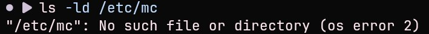
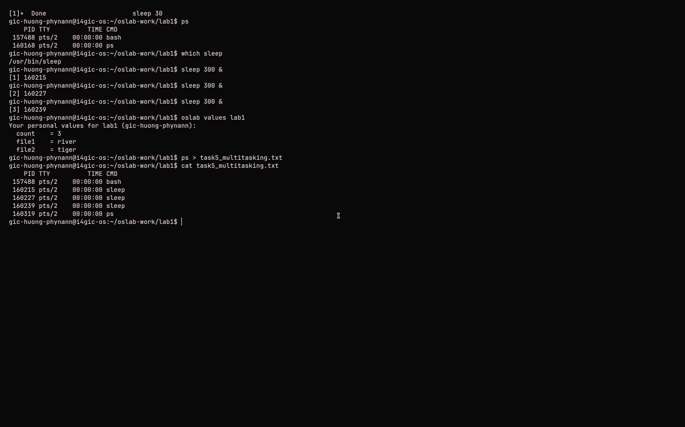
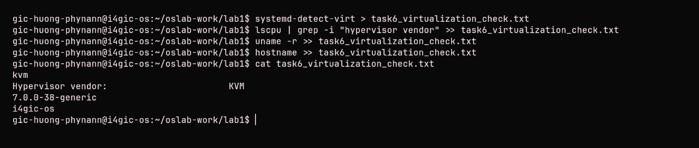

# OS Lab 1 Submission

Copy this template to `os-lab-YOUR_ID/lab1/README.md` in your own repository. Follow [the instructions](lab1-instruction.md). Your prediction and checkpoint answers are already saved by `oslab`; do not copy them here.

- **Student Name: HUONG PHYNANN**
- **Student ID: e20230363**
- **Ubuntu username on the server: gic-huong-phynann**
- **My values** (`oslab values lab1`): file1 = river, file2 = tiger, count = 3

---

## Task 1: Operating System Identification

Briefly describe what you observed about your OS and kernel. Which number is the kernel version, and which is the distribution version?

<!-- You may show the contents of task1_os_info.txt here; no screenshot needed. -->

Linux i4gic-os 7.0.0-38-generic #38-Ubuntu SMP PREEMPT_DYNAMIC Fri Sep  4 09:10:14 UTC 2026 x86_64 GNU/Linux
Distributor ID:	Ubuntu
Description:	Ubuntu 26.04.1 LTS
Release:	26.04
Codename:	resolute

---

## Task 2: Essential Linux File and Directory Commands

Briefly describe your experience creating, copying, renaming and deleting files. What did the last `ls` show?

<!-- You may show the contents of task2_file_commands.txt here; no screenshot needed. -->

/home/gic-huong-phynann/oslab-work/lab1/task2_files
river.txt
tiger.txt
This is file river
This is file tiger
river.txt
river_copy.txt
tiger.txt
river.txt
river_copy.txt
tiger_renamed.txt

I learn creating, copying, renaming, and deleting files using Linux terminal commands such as touch, cp, mv, and rm. These commands helped me understand basic file management in Linux. The last ls command showed the files and directories remaining in the current directory after performing these operations.

---

## Task 3: Package Management Using APT

Explain the difference you observed between `remove` and `purge`.

<!-- SCREENSHOT REQUIREMENT: your terminal after the purge, showing `ls -ld /etc/mc` and your prompt. -->

Answer: remove uninstalls a package but usually keeps its configuration files, while purge uninstalls the package and also removes its system configuration files. Both commands are used to uninstall software, but purge removes more leftover configuration data.

Task 3: 

---

## Task 4: Programs vs Processes

Briefly describe how you ran a background process and found it in the process list. What is the difference between a program and a process? What did you see before, during and after?

Answer: I ran a command in the background by adding & at the end, for example, sleep 30 &. I used ps to find the process in the process list and observed its process ID (PID). Before running it, the process was not present. While it was running, it appeared in the process list. After it finished, it disappeared from the list.
A program a file on the disk, while a process a program that is running.

---

## Task 5: Multitasking

Briefly describe the multitasking you saw. How many `sleep` lines did `ps` show? What does that show about the system, and what does it **not** show about how the processor is shared?

<!-- SCREENSHOT REQUIREMENT: your terminal with the `ps` result and your prompt. -->

Answer:I observed multitasking by running multiple sleep commands at the same time in the background and checking them with ps. The ps command showed multiple sleep lines, meaning several processes were running concurrently. This shows that the operating system can manage multiple processes at once, but it does not show exactly how the CPU shares its processing time between them or whether they run simultaneously on different CPU cores.

Task 5: 

---

## Task 6: Virtualization and Hypervisor Detection

State whether your system is running on a virtual machine or physical hardware, based on the command outputs.

<!-- SCREENSHOT REQUIREMENT: your terminal with the output of the four commands and your prompt. -->
Answer: My system is running on a virtual machine because i use school server to run the system

Task 6: 
---

## My Prediction: Confirmed or Corrected

For each prediction answer (`oslab predict lab1`), write **confirmed** or **corrected** and what you saw that shows it. You test the third answer (`apt-get remove`) in Task 3.

My Answer:
1.    "answers": {
    "file": "y",
    "remove": "y",
    "sleeps": "3",
    "why": "a file on the disk"
    },

2. Confirmed: The apt-get remove command uninstalled the package but kept its configuration files. The terminal showed that the package was removed successfully.
---
